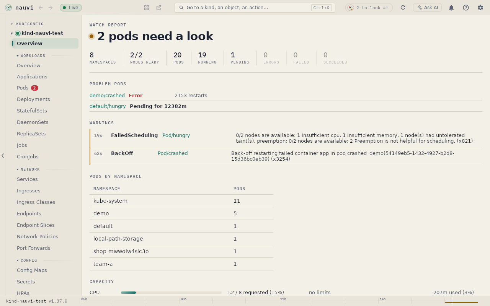

# nauvi

[](https://github.com/nexburst/nauvi/actions/workflows/ci.yml)

**[nexburst.github.io/nauvi](https://nexburst.github.io/nauvi/)** ·
**[Documentation](https://nexburst.github.io/nauvi/docs/)** ·
[Releases](https://github.com/nexburst/nauvi/releases) ·
[Roadmap](https://github.com/nexburst/nauvi/issues/24)

A fast Kubernetes IDE written in Rust: a desktop app (Tauri + Svelte) and a
CLI, both built on the same Rust core. It stays fast while streaming logs and
watching cluster state, and works as a Lens alternative.

<picture>
  <source srcset="docs/user/src/img/overview-dark.png" media="(prefers-color-scheme: dark)">
  
</picture>

Live watches of every resource type (CRDs included), pod and workload logs,
terminals, port forwards, debug containers and node shells, YAML with
server-side apply, the common actions, Helm, several clusters at once with
read-only and protected modes, Ask AI, and `nauvi mcp` for AI assistants.

## Install

Linux and macOS, the desktop app, then only the CLI:

```sh
curl -fsSL https://raw.githubusercontent.com/nexburst/nauvi/main/install.sh | sh
curl -fsSL https://raw.githubusercontent.com/nexburst/nauvi/main/install.sh | sh -s -- --cli
```

Debian and Ubuntu, from the signed apt repository:

```sh
curl -fsSL https://raw.githubusercontent.com/nexburst/nauvi/main/install-apt.sh | sudo sh
```

Homebrew (run `brew trust nexburst/tap` first if Homebrew asks):

```sh
brew install --cask nexburst/tap/nauvi   # the desktop app
brew install nexburst/tap/nauvi-cli      # the CLI
```

Windows (PowerShell), the desktop app, then only the CLI:

```powershell
irm https://raw.githubusercontent.com/nexburst/nauvi/main/install.ps1 | iex
& ([scriptblock]::Create((irm https://raw.githubusercontent.com/nexburst/nauvi/main/install.ps1))) -Cli
```

The app is not code-signed yet: on macOS, an app from Homebrew or a browser
download needs **Open Anyway** in System Settings → Privacy & Security the
first time; on Windows, SmartScreen needs More info → Run anyway.
[Install nauvi](https://nexburst.github.io/nauvi/docs/latest/how-to/install.html)
has every option, downloads by hand and how to check them.

## Documentation

- [Get started in ten minutes](https://nexburst.github.io/nauvi/docs/latest/get-started.html)
- [How-to guides](https://nexburst.github.io/nauvi/docs/latest/how-to/install.html):
  install, update, proxies, port forwards, YAML, several clusters, limited
  access, Ask AI, MCP, moving from Lens
- [The desktop app](https://nexburst.github.io/nauvi/docs/latest/reference/app/navigation.html)
  and [the CLI](https://nexburst.github.io/nauvi/docs/latest/reference/cli/index.html), view by view and command by command
- [Explanations](https://nexburst.github.io/nauvi/docs/latest/explanations/cluster-access.html):
  how nauvi talks to the cluster, what it stores, the security model,
  [size and memory](https://nexburst.github.io/nauvi/docs/latest/explanations/memory.html)
- [Troubleshooting and FAQ](https://nexburst.github.io/nauvi/docs/latest/troubleshooting.html)

The docs come in one version per release; the source is in
[`docs/user/`](docs/user/).

## Status

Early. The first release is
[v0.1.0](https://github.com/nexburst/nauvi/releases/tag/v0.1.0). What comes
next is tracked in the [roadmap (#24)](https://github.com/nexburst/nauvi/issues/24).

## Contributing

[CLAUDE.md](CLAUDE.md) (also `AGENTS.md`) has the code layout, the checks CI
runs and how to run the tests;
[Build from source](https://nexburst.github.io/nauvi/docs/latest/contributing/build.html)
and [the test cluster](https://nexburst.github.io/nauvi/docs/latest/contributing/test-cluster.html)
are in the docs. [docs/ux-standard.md](docs/ux-standard.md) is the UX
standard the app is measured against.

## License

MIT
