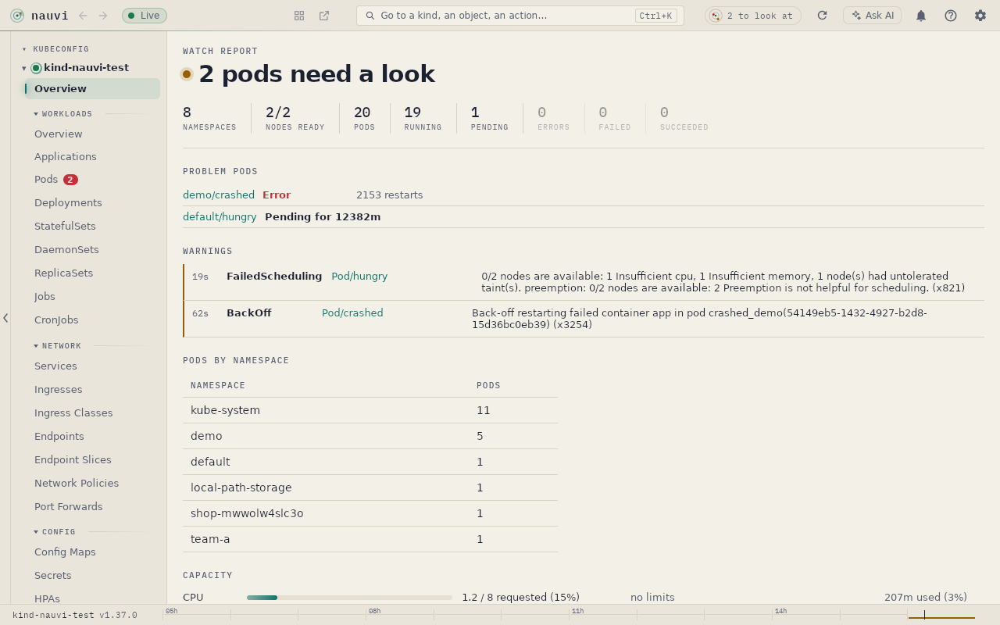
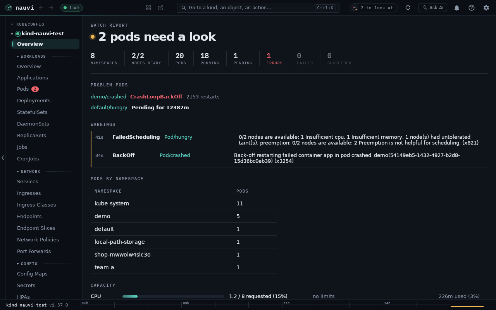
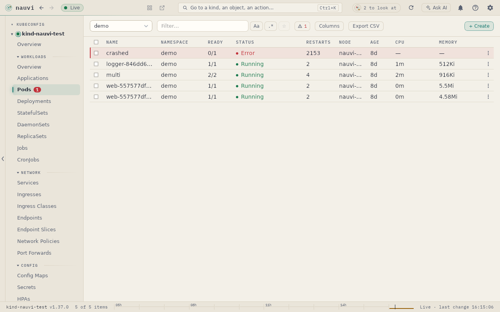
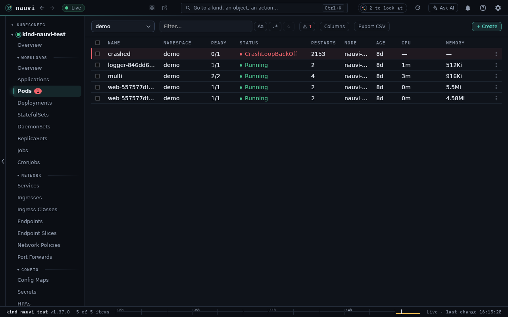
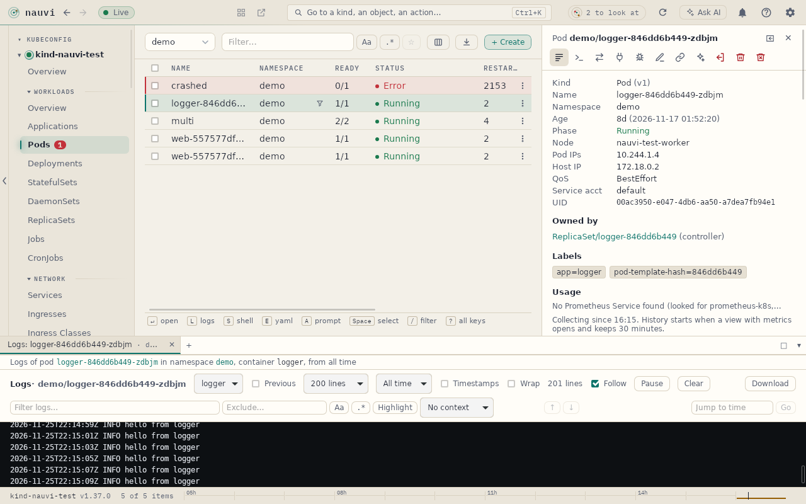
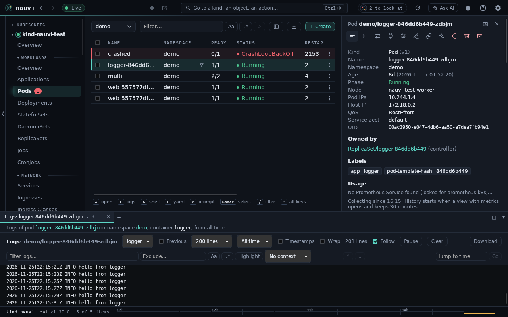
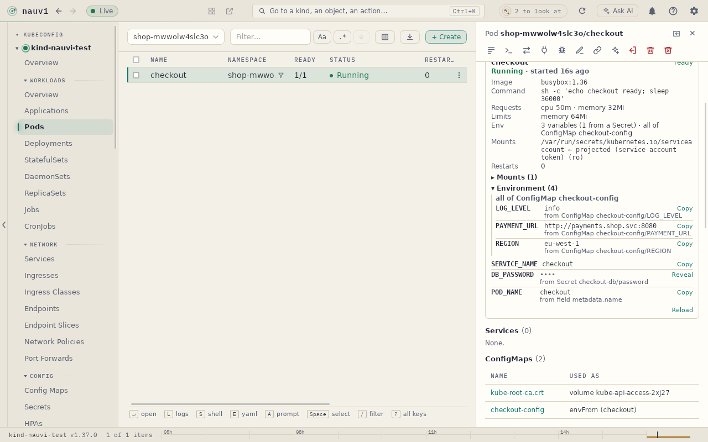
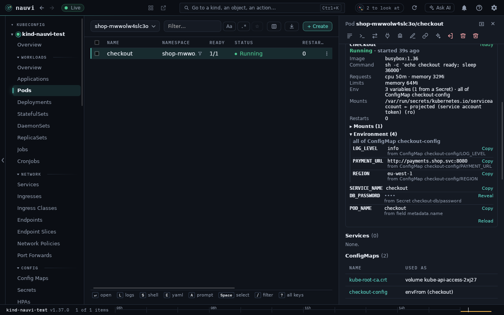
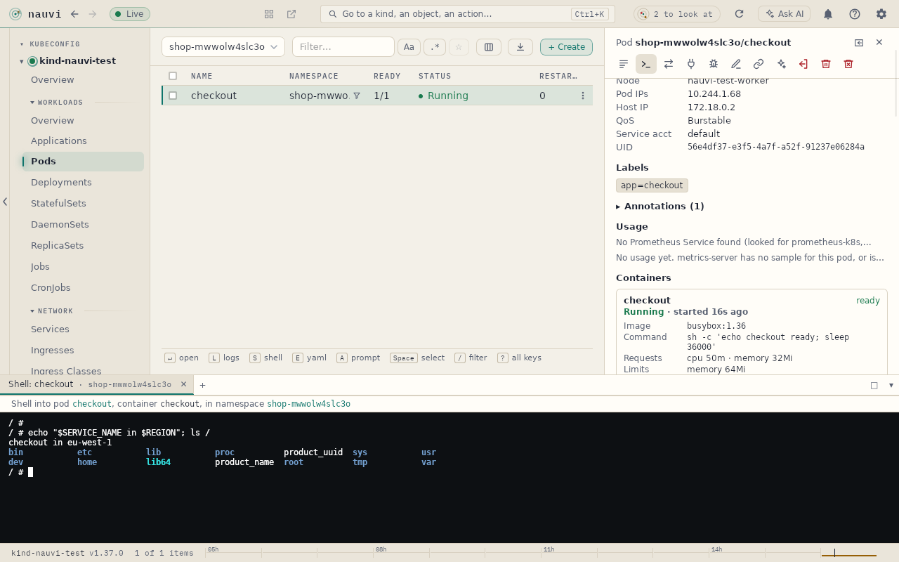
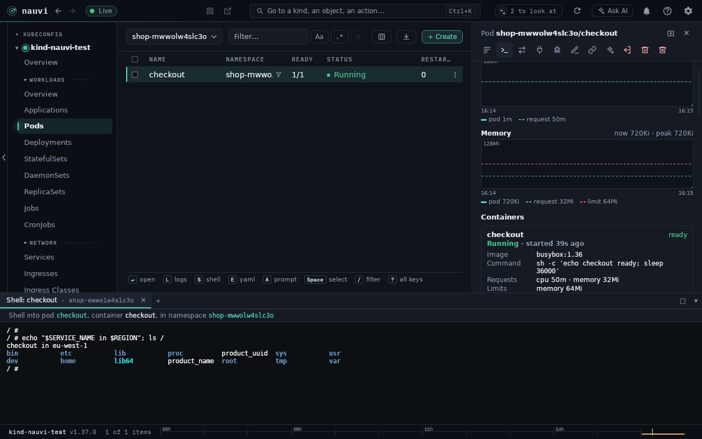

# Get started in ten minutes

This page takes you from nothing to reading a broken pod's logs and opening a
shell in a container. You need a cluster you can reach with `kubectl`. If you
have none, [the test cluster](contributing/test-cluster.md) makes one on your
machine with kind; the screenshots on this page come from it (the `demo`
namespace).

## 1. Install the app

On Linux or macOS, in a terminal:

```sh
curl -fsSL https://raw.githubusercontent.com/nexburst/nauvi/main/install.sh | sh
```

On Windows, in PowerShell:

```powershell
irm https://raw.githubusercontent.com/nexburst/nauvi/main/install.ps1 | iex
```

[Install nauvi](how-to/install.md) has the other ways: apt, Homebrew, and
downloads by hand. On macOS, an app installed with Homebrew or from a browser
download needs one extra click the first time
([why](troubleshooting.md#macos-says-apple-could-not-verify-nauvi)).

## 2. Open it and pick a cluster

Start **nauvi** from your applications menu (on Linux, `nauvi-desktop` from a
terminal works too). nauvi reads the same kubeconfig as `kubectl`
(`KUBECONFIG`, or `~/.kube/config`) and opens its current context. It never
changes your kubeconfig.

The first view is the **Overview**: how many pods need a look, pod counts,
CPU and memory against what is requested, and the newest warning events.




To use another context, click the context selector in the header, or press
`Ctrl+K` (`Cmd+K` on macOS), type `ctx ` and the context's name.

## 3. Find the failing pod

The Overview lists the problem pods; click one to open it. Or go to the Pods
table: press `G`, type `po` and press Enter. The table updates by itself as
pods change. Press `Z`, or click the warning mark in the toolbar, to keep
only the rows that need attention.




The **Containers** column has one square per container: filled green is
ready, amber is starting, red with a cross is crash-looping or failing, grey
is completed. Hover a square to see why.

## 4. Read its logs

Select the pod with the arrow keys (or `j` and `k`) and press `L`, or click
it and choose **Logs** in the panel's header. The logs open in a tab of the
**dock**, at the bottom of the window, and keep streaming while you look at
other things.




For a container that crashed, pick its **previous** instance: that is the
run that failed. Type in the search box to find text, and use **Highlight**
with `Enter` / `Shift+Enter` to step through the matches.
[Logs](reference/app/logs.md) has the rest.

## 5. Look at its environment

Click the pod to open its detail panel. It leads with what is wrong
("CrashLoopBackOff · 12 restarts"), then shows one card per container: image,
command, requests and limits, mounts, and the environment. Open the
**Environment** list to see each variable's value and where it comes from.
Values from Secrets stay hidden until you click **Reveal** on a row.




## 6. Open a shell

With the pod selected, press `S` (or click **Shell** in the panel's header).
A terminal opens in a new dock tab, inside the container.




If the image has no shell, use **Debug…** on the pod instead: it adds a
debug container that sees the other container's processes
([Debugging pods and nodes](reference/app/debugging.md)).

## Next

- Press `?` for every keyboard shortcut, or read
  [Getting around](reference/app/navigation.md).
- [Forward a port to a Service](how-to/port-forward.md).
- [Edit a Deployment's YAML safely](how-to/edit-yaml.md).
- [Work with several clusters](how-to/several-clusters.md).
- Install the CLI too (`install.sh --cli`), then try `nauvi get pods -n demo`.
