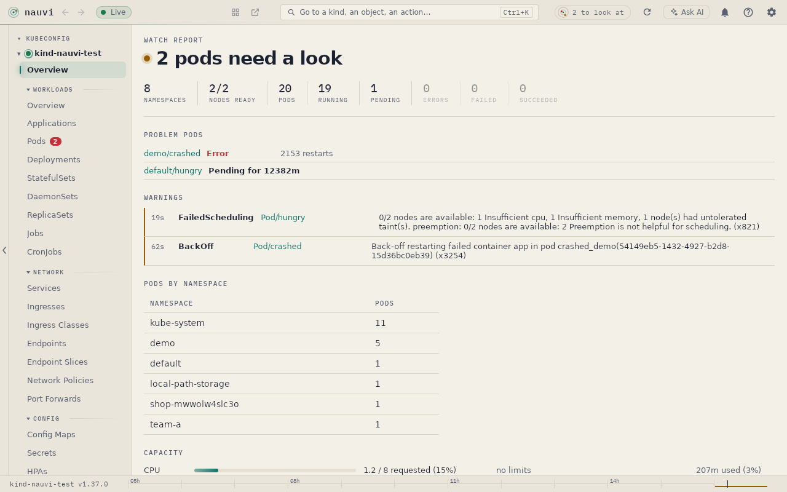
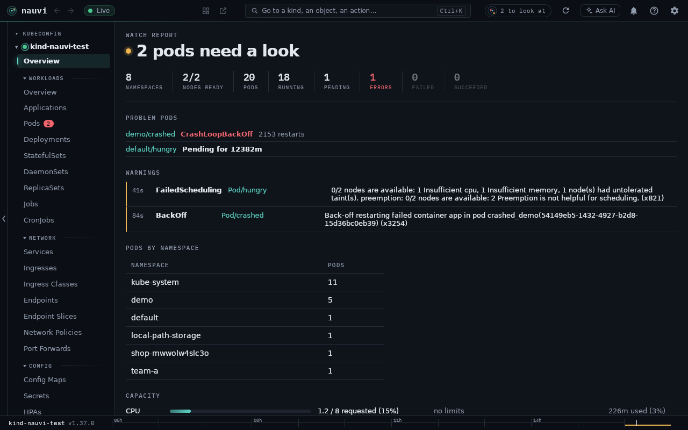

# What is nauvi?

nauvi is a Kubernetes IDE: a desktop app for Linux, macOS and Windows, and a
command-line tool, `nauvi`, both built on the same Rust core. It shows what is
in your clusters and keeps it current while you work, without slowing down
when you stream logs or watch thousands of objects.

With nauvi you can:

- browse **every resource type** the cluster serves, custom resources
  included, in tables kept live by Kubernetes watches;
- read the **logs** of a pod, of its crashed previous container, or of every
  pod of a Deployment at once;
- open **terminals** in pods, debug containers that work on images without a
  shell, root shells on nodes, and your own local shell pointed at the
  cluster;
- **forward ports** to pods, Services and workloads, and keep them saved;
- **edit YAML** with server-side apply, and see which fields you took over;
- run the common **actions**: scale, restart, cordon, drain, evict, trigger
  and delete, each confirmed first and greyed out when you are not allowed;
- look at **Helm** releases and charts, and install and upgrade with a dry run;
- work with **several clusters** at once, each in its own colour, some of
  them read-only or protected;
- **Ask AI**: open your own AI coding CLI about the object on screen, with
  the `nauvi` skill that teaches it how to look at a cluster.

The `nauvi` CLI does much of the same from a terminal or a script: `nauvi
get`, `logs`, `exec`, `port-forward`, `drain`, and `nauvi mcp` for AI
assistants.

## Where to start

- New to nauvi? [Get started in ten minutes](get-started.md): install it,
  connect to a cluster, find a failing pod and read its logs.
- Want a task done? See the **How-to guides** in the sidebar.
- Looking for a view, setting or command? See the **Reference**.
- Wondering how it works or what it stores? See the **Explanations**.
- Something does not work? See [Troubleshooting](troubleshooting.md).

## Status

nauvi is young. The first release is
[v0.1.0](https://github.com/nexburst/nauvi/releases/tag/v0.1.0); what comes
next is in the [roadmap](https://github.com/nexburst/nauvi/issues/24).
It is open source under the
[MIT licence](https://github.com/nexburst/nauvi/blob/main/LICENSE).

These docs exist in one version per release. The menu at the top right
switches between them; **dev** describes the `main` branch, which may have
features no release has yet.
