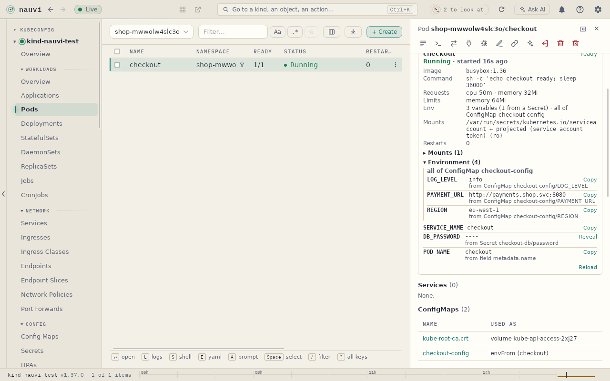
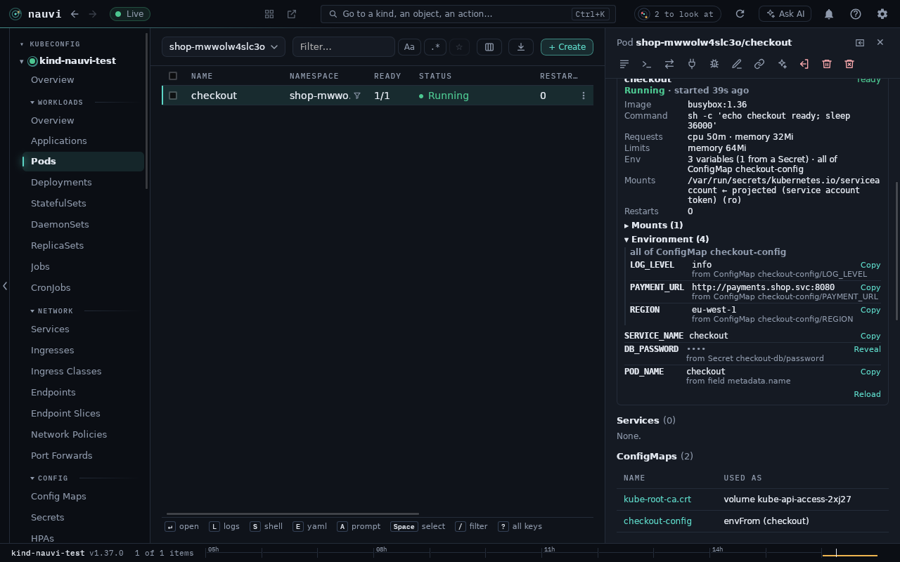

# Detail panels

Click a row, or press `Enter` on it, to open its detail panel on the right.
Every object has one.

- The panel **leads with what is wrong**, in the words of the table
  ("CrashLoopBackOff · 12 restarts").
- Its header has icon buttons for the object's actions: Logs, Shell, Edit,
  Delete, and for example Scale and Restart on workloads, or Cordon and Drain
  on nodes. **Copy link** copies a [`nauvi://` link](links.md) to the object.
- Drag its left edge to change its width; nauvi remembers it.
- `W` gives the object the whole window and gives the table back. The YAML
  tab takes the whole window by itself.
- Hover the creation time for the exact time, in local time or UTC (per
  Settings).

## Pods

Each container card starts with a summary: image, command, args, requests,
limits, the number of environment variables, and the mounts with what each
volume is.

- **Environment** lists each variable with its value and where it comes from:
  a literal, a ConfigMap key (with its source), a pod field, or every key of
  an `envFrom` ConfigMap (with its prefix). Nothing is read until you open
  the list.
- **Secret values are hidden.** Env values from Secrets, and literal values
  that look like secrets, show as `••••` until you click **Reveal** on that
  row; **Hide** and closing the list drop them again. Without permission to
  read the Secret, the row says so.
- Values in command lines that look like secrets (`--token=`, `--password`,
  `…PASSWORD=`, passwords in URLs) are shown as `••••`.
- The panel has the pod's live logs (pick the container, or the previous
  instance of a crashed one) and an interactive terminal.
- CPU and memory charts against requests and limits
  ([Metrics](metrics.md)).

## The last-applied annotation

The panel collapses kubectl's `last-applied-configuration` annotation.
**Show** opens it with secret-looking values masked the same way. The YAML
tab shows it as stored.

## Workloads and nodes

- Deployments, StatefulSets, DaemonSets, ReplicaSets and Jobs chart the summed
  CPU and memory of their pods.
- Nodes chart their usage against allocatable, and have Cordon, Drain and
  Shell in the header.

## Secrets and ConfigMaps

The panel lists their keys and lets you edit them: see
[Secret and ConfigMap data](data.md).
