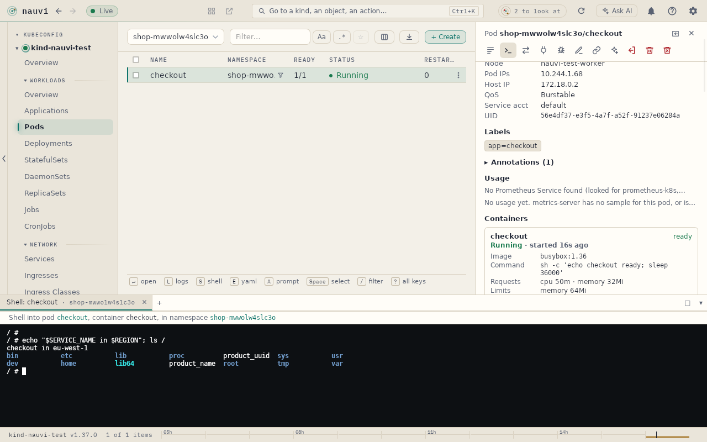
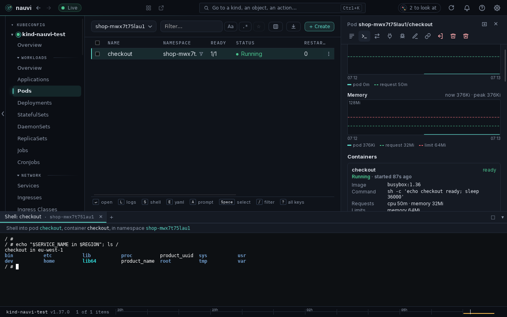

# The dock and terminals

Logs and terminals open in tabs at the bottom of the window, the **dock**, so
several run at once and keep running when you close the panel or switch
views.

## Using the dock

- Open tabs from a panel or the row menu (**Logs**, **Shell**), or with `L`
  and `S` on a row.
- Drag the dock's top edge to resize it; double-click a tab to maximize it.
- `` Ctrl+` `` (the same on macOS, with the Control key) or `Ctrl+J` (`⌘J` on
  macOS) hides or shows it. On Linux and
  Windows, `Ctrl+J` inside a terminal goes to the shell; use `` Ctrl+` ``
  there.
- Each tab has a context line that says what it is attached to (pod,
  container, namespace, since), with links.
- Tabs name the cluster they run on, in the cluster's colour.

## Terminals in pods

**Shell** opens an interactive terminal in a container (pod exec).

- Links a terminal prints (OSC 8) open in your browser when they are http or
  https; other links are ignored.
- `Ctrl+Shift+F` (`⌘F` on macOS) searches a terminal's output: `Enter` /
  `Shift+Enter` for next / previous, **Aa** for match case, `Esc` to close.
  Plain `Ctrl+F` still goes to the shell.
- The terminal's font size is in [Settings](settings.md) (8–32 px); a new
  size applies to open terminals at once.

## Local terminal

**Terminal** in the top bar (next to Ask AI), `Ctrl+T` (`⌘T` on macOS),
`` Ctrl+Shift+` `` (the same on macOS) or `Ctrl+Shift+J` (`⇧⌘J` on macOS),
the dock's **+**, or "New local terminal" in the palette opens your own shell (`$SHELL -l`; on
Windows `pwsh`, `powershell` or `cmd`) in your home directory, with `kubectl`
and `helm` already pointed at the app's context and namespace. The tab shows
`<context> · <namespace>`; changing the app's namespace later does not change
shells that are already open. A cluster's Settings can set the working
directory.

Your own kubeconfig files are never changed. The app writes a temporary
kubeconfig, `nauvi-shell-*.yaml` in the system temp directory:

- For a context of your default kubeconfig, it holds just that context entry
  and comes first in `KUBECONFIG`, before your own files.
- For a context of an added kubeconfig, it is a private copy of that one
  context, made when its login was checked, and the shell sees only it:
  `kubectl config use-context` can't switch to the file's other contexts,
  and changes to the added file apply after the next check. That copy can
  hold the context's credentials (for example a token written in the file).
- On Linux and macOS the file is readable only by you (mode 0600). On Windows
  no mode is set, so who can read it depends on the temp folder's
  permissions.
- It is deleted when the tab closes or the app exits. After a crash, the next
  start deletes it (except on Windows, where leftover files can be deleted
  by hand).

Helm actions on an added kubeconfig use the same kind of copy, deleted when
the command ends.

## Matching kubectl

**Settings → Local terminal → "Offer a kubectl that matches the cluster"**
(off by default). When your kubectl is more than one minor version from the
cluster, a new local terminal offers to download the matching release from
dl.k8s.io.

- Nothing is downloaded until you click.
- The file is checked against the SHA-256 that dl.k8s.io publishes next to
  it. That proves the download is complete and is the file dl.k8s.io serves,
  not that it is signed.
- It is saved in the app's data folder, and local terminals opened later put
  it first on `PATH`. Your own kubectl is never replaced.
- The download uses the cluster's proxy if one is set.
