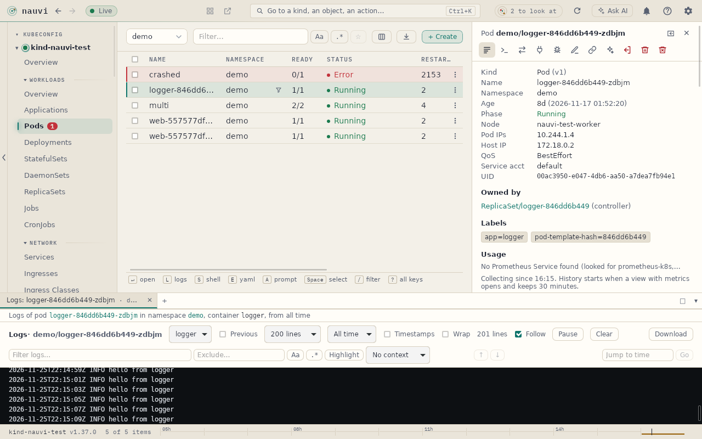
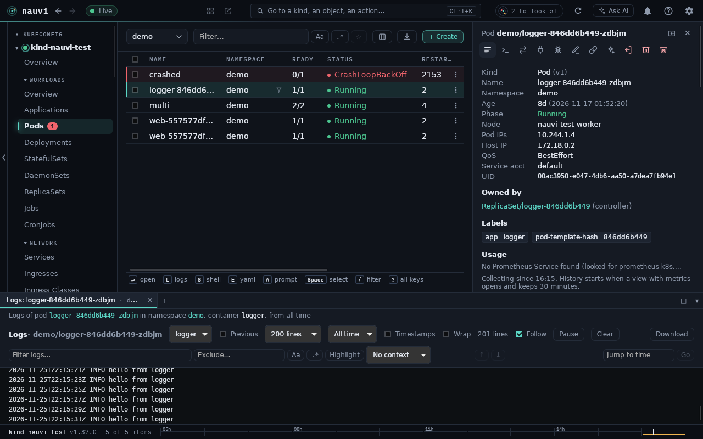

# Logs

nauvi streams logs live into a tab of the [dock](dock.md). Open them with `L`
on a row, **Logs** in the detail panel's header, or the row menu.

## Pod logs

Pick the container, or the **previous** instance of a crashed one: that is
the run that failed. **Follow** keeps the newest line in view.

## Workload logs

Follow every pod of a Deployment, StatefulSet, DaemonSet or Job in one
stream, including pods that a rollout replaces.

## Search

- **Aa** matches case, **.\*** takes a regular expression.
- **Highlight** keeps every line and steps through the matches with `Enter`
  / `Shift+Enter` in the search box, or `n` / `N` in the log. Going to a
  match turns Follow off; tick Follow to go back to the newest line.
- **Exclude** hides the lines that match its text.
- **Context** shows ±N lines around each match.
- **Jump to time** goes to a time of day or a date (needs Timestamps).

## Downloads

A downloaded log starts with a `#` header that says where the lines came from
and which filter was on.

## Limits

At most 10 log streams run at once. A pod's log stream is bounded, so a flood
of lines waits in the API server instead of piling up in the app.

The log viewer's defaults are in [Settings](settings.md). The log viewer stays dark in both themes.

The CLI has the same: [`nauvi logs`](../cli/logs.md).
